<p align="center">
  <a href="https://codiqo.io">
    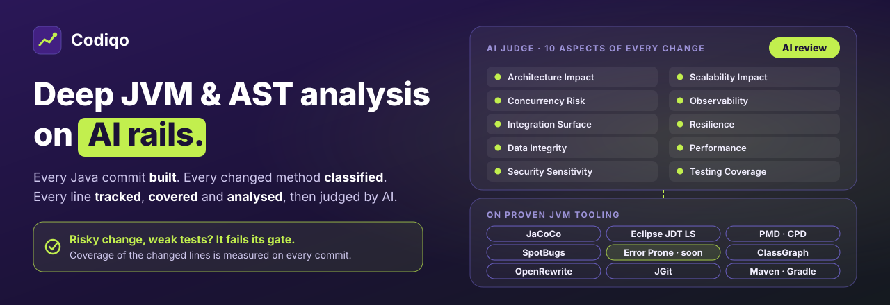
  </a>
</p>

<h3 align="center">Deep JVM and AST analysis on AI rails.<br>Every Java commit built, every changed method classified, every line tracked — then judged by AI.</h3>

<p align="center">
  <a href="https://codiqo.io"></a>
  
  
  <a href="DRIVER_SCORE.md"></a>
  
</p>

<p align="center">
  <a href="#get-started">Get started</a> ·
  <a href="#ten-aspects-one-ai-judge">10 aspects</a> ·
  <a href="#coverage-is-a-hard-line">Coverage gate</a> ·
  <a href="#built-on-proven-jvm-tooling">Tooling</a> ·
  <a href="#a-score-you-can-audit">Scoring model</a> ·
  <a href="#tune-it-to-your-team">Settings</a> ·
  <a href="#screenshots">Screenshots</a>
</p>

---

**Codiqo gives every Java commit an AI review that stands on facts, not on a diff.** It builds the commit, parses
every changed method, tracks every changed line through coverage and static analysis, and only then lets an AI judge
the change from ten aspects. An open, deterministic formula turns facts and judgement into one contributed value.

- **AI judges every change from ten aspects.** Architecture, concurrency, integration, data integrity, security,
  scalability, observability, resilience, performance and test coverage — each with its own gate.
- **Every method classified, every line tracked.** Each changed method is labelled mechanical, routine, substantive or
  intricate, and each changed line is tracked as new, modified, moved or removed, covered or not.
- **Risky change, weak tests: it fails its gate.** Coverage of the changed lines is measured in the real build of that
  commit, and risky code without a fitting test is penalised.
- **Every point is explainable.** Each score traces back to the methods that earned it, through a model that is
  [published in full](DRIVER_SCORE.md).

<p align="center">
  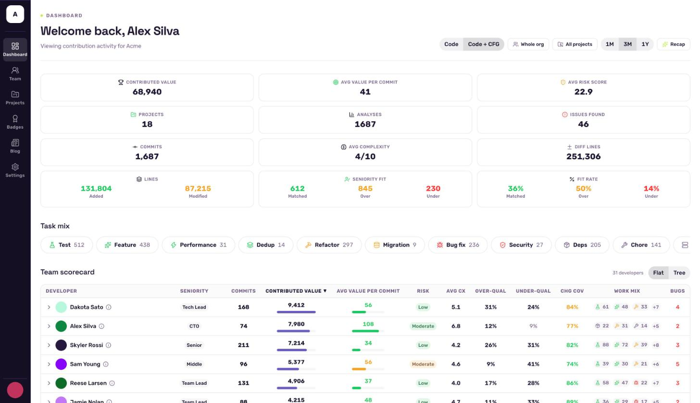
</p>

## Why Codiqo

**An AI that reads only a diff is guessing.** It cannot see whether the change is tested, how far it reaches, or
whether the "new" code was moved from elsewhere. Codiqo builds the commit first, so the AI judges measured facts.

| | AI on the diff alone | AI on the build, with Codiqo |
|---|---|---|
| **Judgement** | A model reads text | A model judges ten aspects against measured facts |
| **Test coverage** | Unknown | JaCoCo coverage of exactly the changed lines, gated |
| **Impact** | Guessed | Callers of every changed method, resolved by Eclipse JDT LS |
| **Moved code** | Counted as new work | Detected across files and discounted |
| **Code structure** | Lines of text | Parsed AST per method and constructor |
| **Score** | A model's number | A [documented formula](DRIVER_SCORE.md), traceable to every changed method |

## Get started

> [!IMPORTANT]
> Codiqo is pre-release and published as `1.0-SNAPSHOT` to the
> [Maven Central snapshot repository](https://central.sonatype.com/repository/maven-snapshots/). You need JDK 21 or
> newer and an account at [codiqo.io](https://codiqo.io).

<details open>
<summary><b>Maven</b></summary>

Enable the snapshot repository once, for example in a `~/.m2/settings.xml` profile:

```xml
<pluginRepository>
  <id>central-snapshots</id>
  <url>https://central.sonatype.com/repository/maven-snapshots/</url>
  <releases><enabled>false</enabled></releases>
  <snapshots><enabled>true</enabled></snapshots>
</pluginRepository>
```

Then, from the root of your project:

```bash
# 1. authorise this machine in the browser (once)
mvn io.codiqo:codiqo-maven-plugin:1.0-SNAPSHOT:login

# 2. analyse the latest commit
mvn io.codiqo:codiqo-maven-plugin:1.0-SNAPSHOT:submit-commit-analysis -Dcodiqo.commitId=$(git rev-parse HEAD)

# 3. or review the work you have not committed yet
mvn io.codiqo:codiqo-maven-plugin:1.0-SNAPSHOT:analyze-uncommitted-changes
```

</details>

<details>
<summary><b>GitHub Actions</b></summary>

[codiqo-action](https://github.com/codiqo/codiqo-action) analyses every pushed commit:

```yaml
- uses: actions/checkout@v7
  with:
    fetch-depth: 0
- uses: codiqo/codiqo-action@main
  with:
    api-key: ${{ secrets.CODIQO_API_KEY }}
```

</details>

<details>
<summary><b>Gradle</b></summary>

Codiqo applies to a Gradle build through an init script, with no change to your build files. Start from
[`gradle-plugin/codiqo.init.gradle`](gradle-plugin/codiqo.init.gradle), add the snapshot repository above to its
`initscript` repositories, then run:

```bash
./gradlew --init-script codiqo.init.gradle --continue \
    test codiqoSubmitAnalysis -Pcodiqo.apiKey=env:CODIQO_API_KEY
```

`codiqoLogin` authorises the machine in the browser, and `codiqoIndexCommits` lists the commits still to analyse.

</details>

## Ten aspects, one AI judge

**Every change is reviewed from the same ten aspects, and nine of them carry a gate the change must pass.** The AI
scores each aspect from 0 to 10 with a written rationale. When an aspect matters for the change and its gate is not
met, the commit is penalised.

| Aspect | The gate |
|---|---|
| **Architecture Impact** | A high-impact change (7 or more) has at least 80% of its changed lines covered by tests |
| **Concurrency Risk** | A test exercises the new or changed shared state, locking or async code concurrently |
| **Integration Surface** | A new API, endpoint, message or contract has an integration or contract test |
| **Data Integrity** | New or changed persistence or transaction code is tested against a database or in a transaction |
| **Security Sensitivity** | No secret, credential or personal data is exposed, and changed authentication or authorisation code is tested |
| **Scalability Impact** | A new bottleneck or hot path has a load test or benchmark |
| **Performance** | A new bottleneck or hot path has a load test or benchmark |
| **Observability** | New logging, metrics or tracing is shown working, for example in a test |
| **Resilience** | New retry, fallback, timeout or error-handling paths have a test that drives the failure |
| **Testing Coverage** | Measured by the build, not judged: the coverage of the changed lines |

<p align="center">
  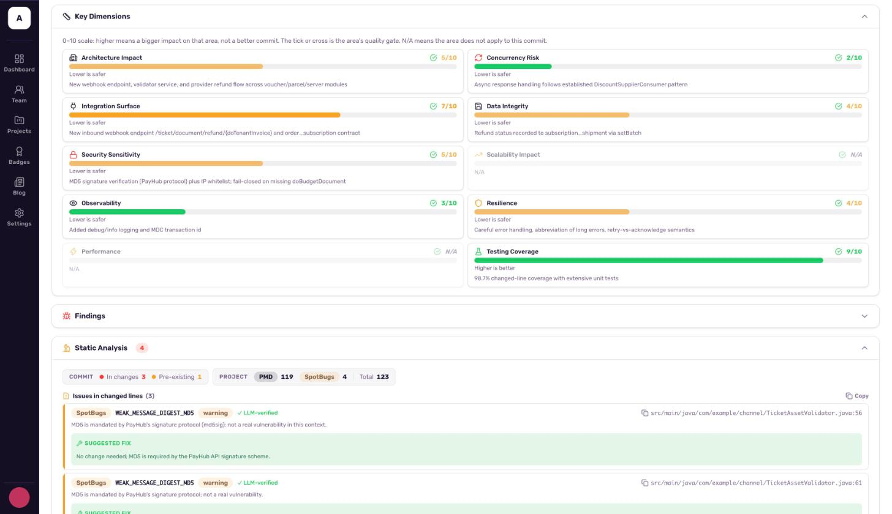
</p>

The same review also classifies the change: its intent (feature, bug fix, refactor, test, migration and more), its
complexity, and a difficulty label for every changed method.

## Coverage is a hard line

**A risky change with weak tests is a no-go, and Codiqo prices it that way.** Codiqo attaches JaCoCo to the real build
of every commit and reports the coverage of exactly the lines that commit touched, next to the whole-project figure.

- **Coverage moves the score.** The coverage of the changed lines sets part of the commit's quality multiplier:

  | Changed-line coverage | 90%+ | 80–90% | 70–80% | 60–70% | 50–60% | below 50% |
  |---|---|---|---|---|---|---|
  | Quality multiplier | **+10%** | +5% | 0 | −5% | −10% | **−15%** |

- **Risk demands tests.** Each failed [gate](#ten-aspects-one-ai-judge) costs a further 3%, up to 10%, so a risky
  change without tests can never score like a tested one.
- **Trends show the drift.** Every project page charts the coverage of each commit's changed code over time.

<p align="center">
  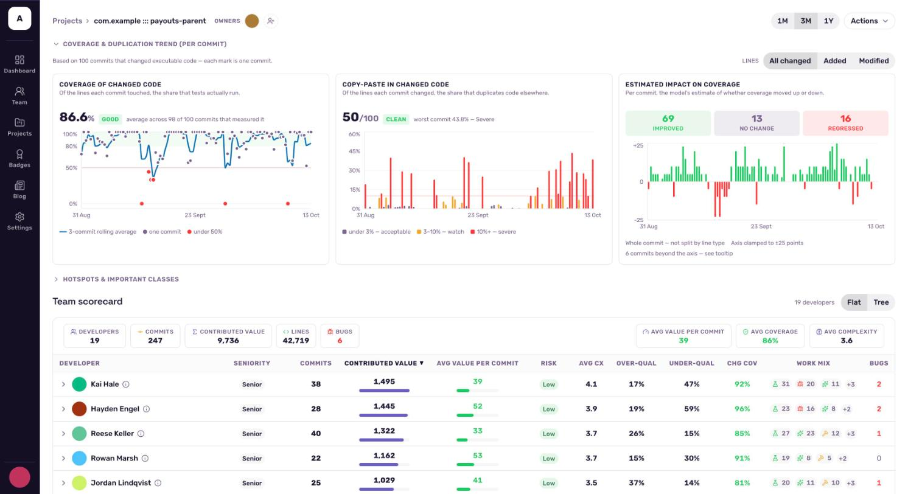
</p>

## Built on proven JVM tooling

**The AI judges; established JVM tools measure.** Codiqo runs them inside the build of each commit and hands their
results to the review, which confirms real problems and explains false alarms.

| Tool | What Codiqo uses it for |
|---|---|
| **JaCoCo** | Line and branch coverage of the changed code |
| **Eclipse JDT Language Server** | The resolved call graph: who calls each changed method (blast radius) |
| **PMD** | The AST of every method: statements, complexity, and rule findings on added lines |
| **PMD CPD** | Copy-paste introduced by the change |
| **SpotBugs** | Bytecode-level bug patterns on added lines, validated by the AI review |
| **Error Prone** *(coming soon)* | Compile-time bug patterns from the Java compiler, validated by the AI review |
| **ClassGraph** | Resolution of invoked methods to the classes and libraries that declare them |
| **OpenRewrite** | The optional `normalize-sources` clean-up of a codebase |
| **JGit** | Commit history, diffs, and a clean clone of every analysed commit |
| **Maven and Gradle** | The real build of each commit, tests included |

**Every finding is checked by the AI before it counts.** A real defect becomes a bug on the commit; a false alarm is
marked verified and explained, with a suggested fix:

<p align="center">
  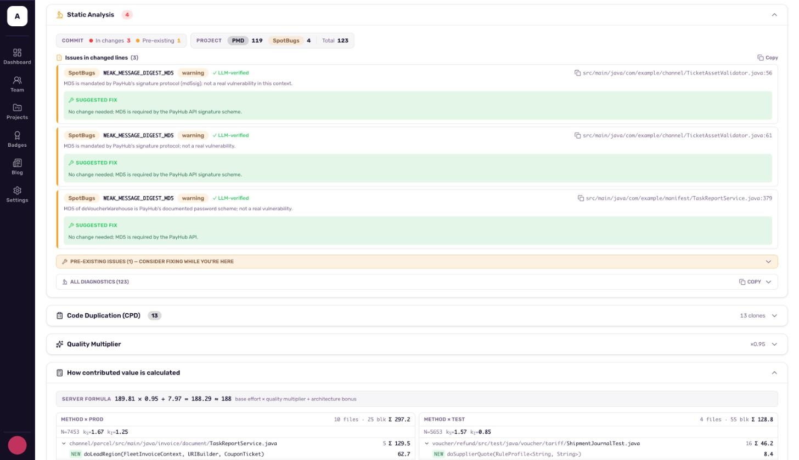
</p>

## What you get on every commit

**One contributed value per commit, and the evidence behind it.**

| | |
|---|---|
| **AI review** | Ten aspects scored with rationale, gates checked, a written summary, and a full trace of what the agents did |
| **Contributed value** | The size of the work, priced per method, adjusted for difficulty and quality, with risk and seniority fit beside it |
| **Method classification** | Every changed method labelled mechanical, routine, substantive or intricate |
| **Changed-line coverage** | How much of what the commit touched its tests actually run |
| **Blast radius** | Who calls the changed methods, and whether anything outside the module is affected |
| **Line tracking** | Every changed line classified as a real edit, new code, removal or moved code |
| **Validated findings** | Static-analysis findings on added lines, confirmed as bugs or explained as false alarms |
| **Duplication and hotspots** | Copy-paste introduced by the change; the files and classes that change most |

Team dashboards, per-project trends and per-developer scorecards build on these numbers at
[codiqo.io](https://codiqo.io).

## How a commit becomes a score

**Three deterministic stages produce the facts; one AI stage judges them; rules produce the number.**

<p align="center">
  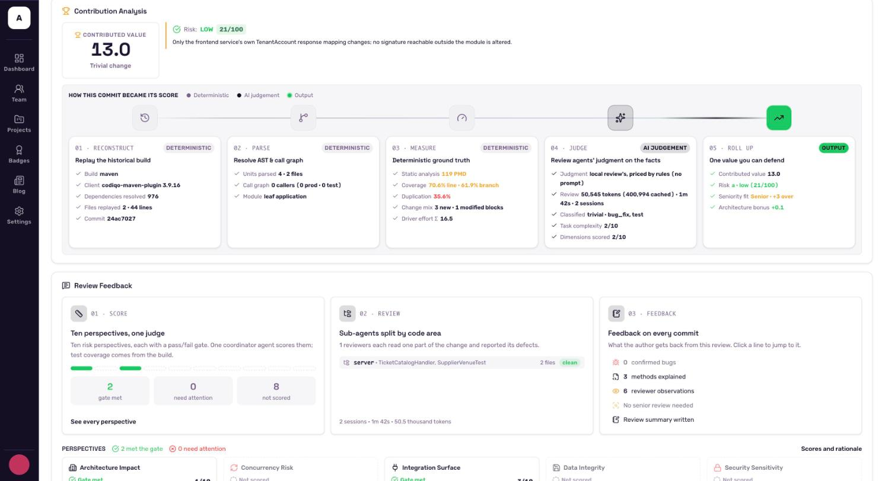
</p>

1. **Reconstruct** — the commit is cloned into its own work tree and its build is replayed.
2. **Parse** — methods and constructors are parsed into an AST, and the call graph is resolved.
3. **Measure** — coverage, duplication, static analysis and the change mix: deterministic ground truth.
4. **Judge** — review agents read the change and judge it against those facts.
5. **Roll up** — rules turn facts and judgement into one contributed value, with risk and seniority fit beside it.

## A score you can audit

**The score is a formula, not a model's opinion.** The AI decides only how hard each changed method was; everything
else is measured. The full model, with every constant and worked examples, is in [DRIVER_SCORE.md](DRIVER_SCORE.md).

<p align="center">
  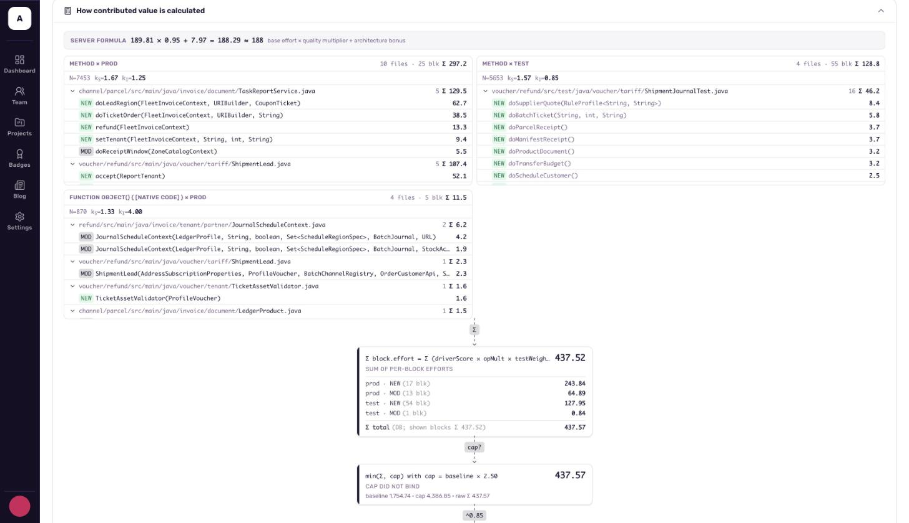
</p>

**Every changed method gets a driver score**, a lines-equivalent measure of how much work it is. It combines three
signals, so neither verbose builders nor dense loops can game it:

- **L**: non-comment lines in the method body
- **S**: logical statements (NCSS)
- **I**: distinct method invocations; a fluent builder chain counts once

```
new method:       driver = (L + S·k_S + 0.5·I·k_I) / 2.5
modified method:  driver = (linesChanged + 0.5·invocationsChanged·k_I) / 1.5
```

**It calibrates to your codebase.** `k_S` and `k_I` are your project's own median ratios (`lines.p50 / ncss.p50`,
`lines.p50 / invocations.p50`), computed separately for methods and constructors, production and test code. One
statement is worth as many lines as it takes in *your* style, and an outlier method cannot skew the rest.

**It is built to resist gaming.** A score that pays for volume invites padding, so every cheap trick is priced out:

| Trick | Why it does not pay |
|---|---|
| Long fluent chains and builder setters | A run of same-type chained calls counts as one invocation |
| Splitting statements across many lines | Lines are weighed against statements and invocations at the project's own medians |
| Moving code between files | Relocated lines are matched and cost a quarter of new work |
| Reformatting, re-indenting, renaming | Delete-and-add pairs count once; mechanical changes are priced at ×0.7 |
| Inflating tests | Test code is weighted ×0.4 |
| One giant change | The commit's total is capped at 2.5× its baseline budget, with diminishing returns above |
| Engineered outlier methods | Blocks whose statement or invocation density departs more than 75% from the project's norm are flagged for review |

**Each layer prices exactly one thing:**

| Layer | What it prices | How |
|---|---|---|
| Driver score | How much code | Median-calibrated lines, statements and invocations |
| Difficulty | How hard | Review label: mechanical ×0.7, routine ×1.0, substantive ×1.2, intricate ×1.4 |
| What really changed | Edits, not churn | Delete-and-add pairs count once; moved lines cost ×0.25 |
| Purpose | Test or production | Test code ×0.4 |
| Commit size | Diminishing returns | Summed effort ^0.85, with a global cap at 2.5× the project's baseline |
| Quality | Outcomes | Coverage, duplication, static analysis, architecture; clamped to ×0.5–×1.2 |

## Tune it to your team

**Every default is a setting, and every setting can be overridden.** Build and review settings are plugin properties
(`-Dcodiqo.…` for Maven, `-Pcodiqo.…` for Gradle); scoring settings travel with each submission, and an organisation
or project override at [codiqo.io](https://codiqo.io) replaces them for a whole history at once. Precedence:
submitted value, then organisation override, then project override.

**The settings most teams look at first:**

| Setting | Default | What it controls |
|---|---|---|
| `codiqo.review` | `true` | The local AI review of every commit |
| `codiqo.review.baseUrl` | Codiqo's model proxy | The model endpoint: any OpenAI-compatible URL, such as a local Ollama |
| `codiqo.review.coordinatorModel`, `codiqo.review.reviewerModel` | `deepseek-v4.1-flash:cloud`, `glm-5.3-flash:cloud` | The models that judge and review |
| `codiqo.review.timeoutMinutes` | `60` | The time a review may take |
| `codiqo.buildTimeoutMinutes` | `45` | The time the build of one commit may take |
| `codiqo.skipOnBuildFailure` | `true` | Carry on when a commit's build fails, instead of failing the whole run |
| `codiqo.excludePaths`, `codiqo.excludeAuthorEmails` | none, `*bot*` | Files and commit authors kept out of the analysis |
| `codiqo.firstParentOnly`, `codiqo.excludeRevertedCommits` | `true`, `true` | Which commits of the history count |
| `codiqo.ignoreCoverage`, `codiqo.ignoreCpd` | `false`, `false` | Skip a measurement for projects that cannot run it |
| `codiqo.pmdRules`, `codiqo.pmdMinPriority` | PMD's best practices, design, error-prone, performance and multithreading rules plus Codiqo's code style; `HIGH` | The PMD rules applied and the lowest priority reported |

**The scoring settings that move the number most:**

| Setting | Default | What it controls |
|---|---|---|
| `driverScoreCapMultiplier` | `2.5` | The global cap on a commit's summed effort, as a multiple of its baseline budget |
| `driverFactorMaxDeviation` | `0.75` | How far a method may depart from the project's norm before it is flagged |
| `driverScoreCapDryRun` | `false` | Audit the cap without applying it |
| `volumeExponent` | `0.85` | Diminishing returns on commit size |
| `testCodeScoreMultiplier` | `0.4` | The weight of test code |
| `movedLineCoefficient`, `moveSimilarityThreshold` | `0.25`, `0.95` | What moved code costs, and how similar it must be to count as moved |
| `qualityMultiplierMin`, `qualityMultiplierMax` | `0.5`, `1.2` | The range quality can move the score |
| `coverageImpact*Min`, `coverage*Bonus`, `coverage*Penalty` | 90 / 80 / 70 / 60 / 50%; +10% to −15% | The coverage bands above |
| `architectureImpactCoverageRequired` | `80` | The coverage a high-impact change needs to pass its gate |
| `deleteRewardWeight` | `0.2` | Credit for removing code |

`driverScoreCapMultiplier`, `driverFactorMaxDeviation`, `driverScoreCapDryRun`, `moveDetectionEnabled`,
`moveSimilarityThreshold` and `movedLineCoefficient` can also be set from the build with `-Dcodiqo.…`. More than a
hundred settings exist in all; every
default lives in [`RunArgs`](api/src/main/java/io/codiqo/api/RunArgs.java), and the scoring ones are explained in
[DRIVER_SCORE.md](DRIVER_SCORE.md#configuration). The four difficulty coefficients always take the server's defaults.

## The AI review

**The review runs inside your build, on your machine or runner.** It is on by default (`-Dcodiqo.review=false` turns
it off) and uses OpenCode in the analysis clone, so reviewers read your code through git and see the facts the build
measured.

- **Bring your own model.** Requests go through a loopback relay to `codiqo.review.baseUrl`: Codiqo's model proxy by
  default, or any OpenAI-compatible endpoint, such as a local Ollama.
- **Nothing is hidden.** Every review leaves a trace, `codiqo-review-trace-<sha>.json`, with each agent's messages and
  tool calls; secrets from the build environment are scrubbed from it before upload.

<p align="center">
  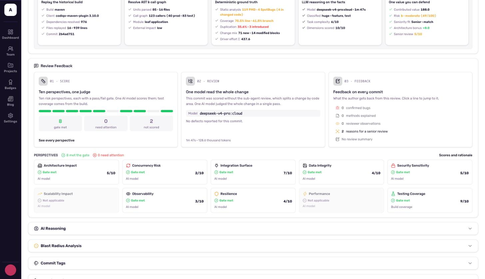
</p>

## Screenshots

<table>
  <tr>
    <td width="50%">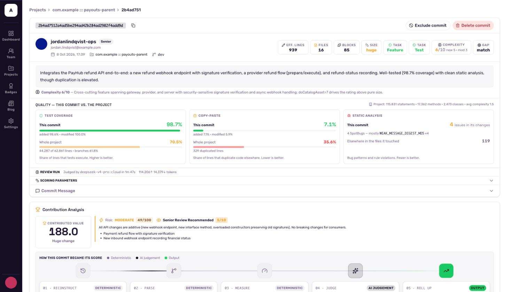</td>
    <td width="50%">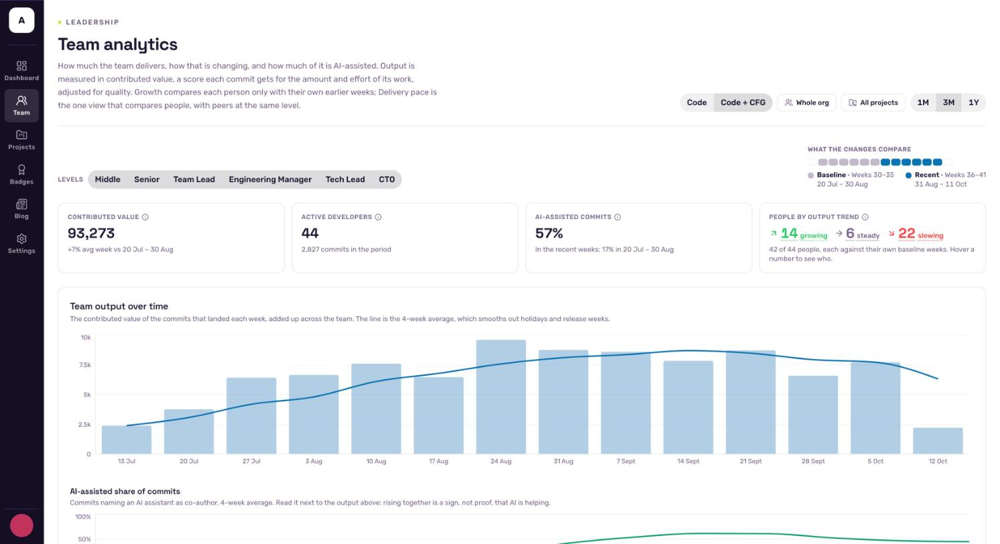</td>
  </tr>
  <tr>
    <td align="center"><b>Commit analysis</b> — the AI summary, and what the commit did to coverage and duplication</td>
    <td align="center"><b>Team analytics</b> — output over time, and how much of it is AI-assisted</td>
  </tr>
  <tr>
    <td width="50%">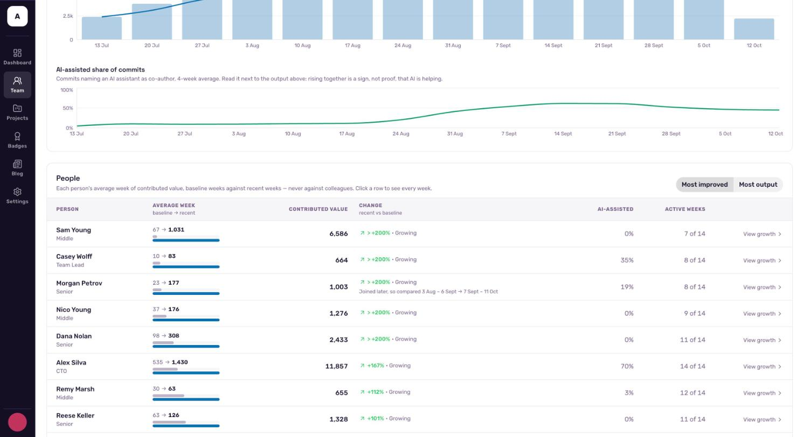</td>
    <td width="50%">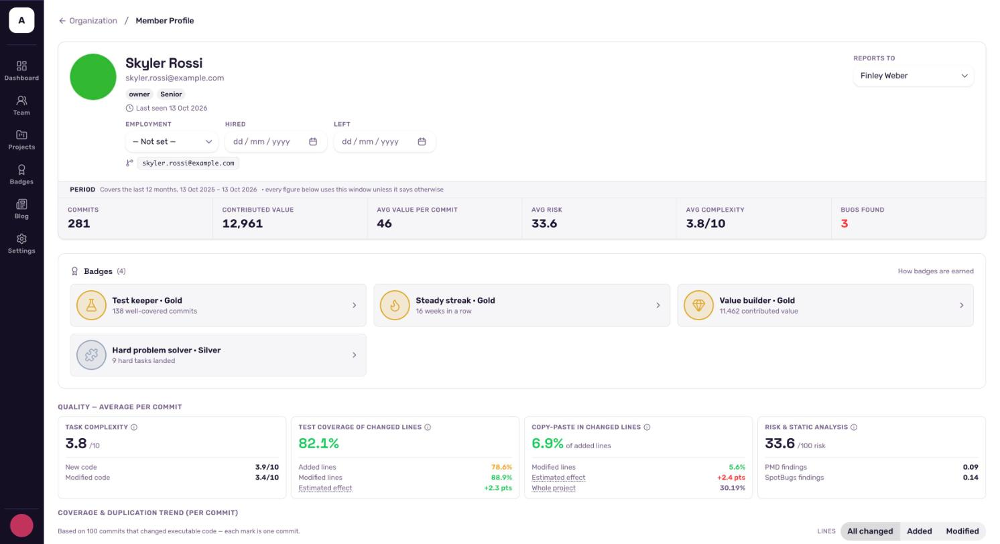</td>
  </tr>
  <tr>
    <td align="center"><b>Growth per person</b> — each developer against their own earlier weeks, never against colleagues</td>
    <td align="center"><b>Developer profile</b> — value, badges, and the quality of an average commit</td>
  </tr>
  <tr>
    <td width="50%">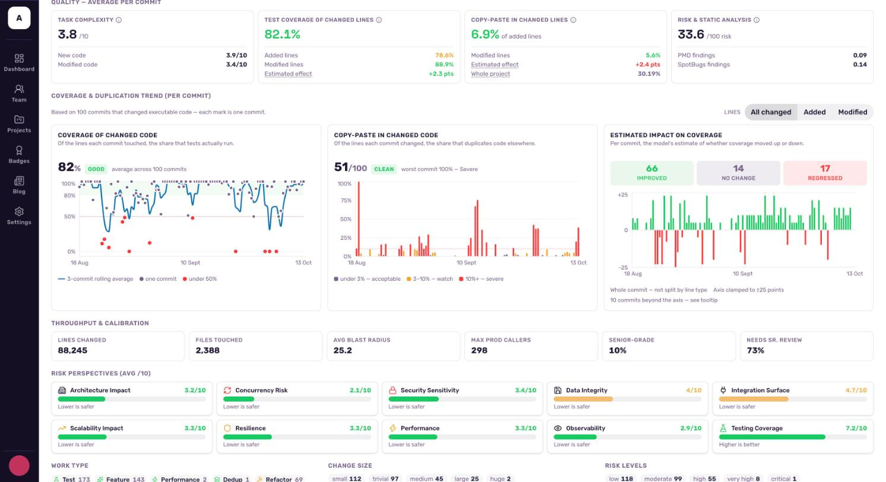</td>
    <td width="50%"></td>
  </tr>
  <tr>
    <td align="center"><b>Risk perspectives per developer</b> — the ten aspects averaged over their commits</td>
    <td align="center"><b>Project trends</b> — coverage and duplication of every commit's changed code</td>
  </tr>
</table>

## Reference

<details>
<summary><b>Maven goals</b></summary>

| Goal | What it does |
|---|---|
| `login` | Authorises this machine through the browser; the login is shared with the Gradle plugin |
| `submit-commit-analysis` | Builds and analyses one commit (`-Dcodiqo.commitId`) and submits it |
| `analyze-uncommitted-changes` | Analyses the working tree, untracked files included |
| `index-commits` | Lists the commits in a window (`-Dcodiqo.commitWindow`, default three months) still to analyse |
| `review` | Runs the AI review of a commit locally and writes it to `target/codiqo-review.json`; nothing is built or submitted |
| `normalize-sources` | Applies a set of OpenRewrite clean-up recipes; a dry run by default |
| `submit-analysis-file` | Submits an analysis saved to a file |

</details>

<details>
<summary><b>Requirements</b></summary>

- JDK 21 or newer to run the plugins.
- Maven 3.10 or newer, or Gradle.
- The `opencode` executable on the `PATH` for the AI review (`npm install -g @opencode/cli`; the GitHub Action
  installs it for you).
- A Codiqo account: [codiqo.io](https://codiqo.io).

</details>

<details>
<summary><b>Repository layout</b></summary>

| Module | Contents |
|---|---|
| `maven-plugin` | The Maven goals |
| `gradle-plugin` | The Gradle plugin and its init script |
| `lang-java`, `lang-config` | Java parsing and metrics (PMD, JaCoCo, SpotBugs, JDT LS); build and schema files |
| `core`, `api`, `submit` | The analysis engine, its settings and the submission model |
| `llm` | The local AI review and the scoring rules |
| `maven-time-machine`, `maven-*-injector`, `maven-build-eventspy` | Maven extensions that replay historical builds and attach coverage and test limits |

</details>

## Contributing

Issues and pull requests are welcome. Build everything with `mvn install`; the coding conventions are in
[CLAUDE.md](CLAUDE.md).

## License

Codiqo is licensed under the [Apache License 2.0](LICENSE).

Codiqo and the Codiqo logo are trademarks of Codiqo; the licence does not grant permission to use them.
